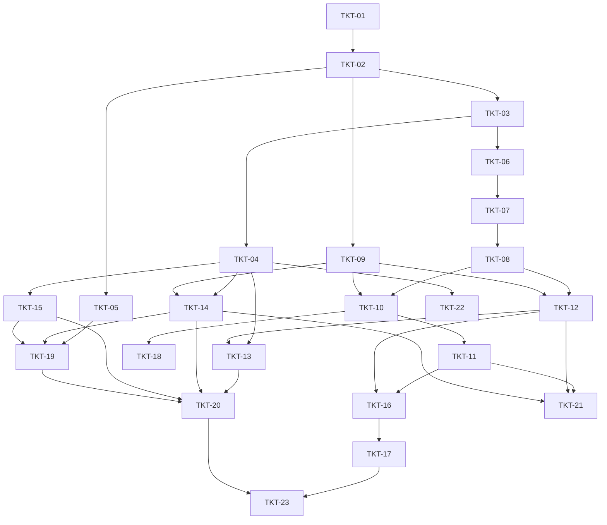

# Verilane — Tickets

> Stage 4 · Problem Breakdown · Campfire TASK-4 · 2026-10-30 · Milestones: [`milestones.md`](milestones.md) · Campfire IDs added Stage 5 (TASK-5)
> **IDs:** `TKT-##` / `TSK-##` are provisional. Stage 5 onboarded them into Campfire (mapping in the table below: `TKT-01 → TASK-6` … `TKT-23 → TASK-28`); native IDs are used from then on. `TC-###` IDs are reserved here and authored in full in Stage 5's `test-cases.md`; they never change once assigned.
> **Types/priorities** follow the global CLAUDE.md (type ∈ bug · feature · enhancement · task · chore · docs · spike; P0/P1 → High, P2 → Medium, P3 → Low).
> **Estimates:** `sp:` story points (1 ≈ a short session, 5 ≈ a full fresh context window; nothing above 5).

## Common Definition of Done (applies to every ticket)
1. Typecheck, lint (incl. the SR2 domain-import rule) and the ticket's tests pass; TDD for domain code.
2. Every new data view ships its four states (loading · empty · error · working, Design.md §18) and is disabled-with-reason, never hidden, when an action is unavailable.
3. Every new route passes axe with 0 serious/critical violations in both themes, and has no horizontal scroll at 390px (once TKT-15 lands, at all four widths).
4. No dead controls: every visible control does something real or is disabled with a stated reason.
5. Verified in the running app (not only by tests); listed `TC-` IDs pass; Campfire status moved to Done only after verification.

## Dependency DAG

**Critical path:** TKT-01 → 02 → 03 → 06 → 07 → 08 → 10 → 11 → 16 → 17 → 23 (with 20/21 closing M-006).
**Parallel lanes after TKT-03:** {TKT-04, TKT-05, TKT-09, TKT-22} alongside the email lane {TKT-06 → 07 → 08}.

| ID | Campfire | Title | Type | Pri | Milestone | Blocked by | sp |
|---|---|---|---|---|---|---|---|
| TKT-01 | TASK-6 | Scaffold repo and app shell | chore | P0 | M-001 | — | 3 |
| TKT-02 | TASK-7 | Tracer: seed → IndexedDB → priority → Queue → evidence | feature | P0 | M-001 | 01 | 5 |
| TKT-03 | TASK-8 | Full synthetic seed + coverage test | task | P0 | M-001 | 02 | 3 |
| TKT-04 | TASK-9 | Queue: search, filters, sort, paging, four states | feature | P0 | M-001 | 03 | 3 |
| TKT-05 | TASK-10 | Storage fallback banner (SR9) | feature | P1 | M-001 | 02 | 2 |
| TKT-06 | TASK-11 | Author eval labels + held-out set (before extractor) | task | P0 | M-002 | 03 | 3 |
| TKT-07 | TASK-12 | Simulated extractor + classifier → Communication evidence | feature | P0 | M-002 | 06 | 5 |
| TKT-08 | TASK-13 | Strict matcher, review items, gates G4/G5/G7, Payments page | feature | P0 | M-002 | 07 | 5 |
| TKT-09 | TASK-14 | Command core: permissions, transitions, audit + Audit log | feature | P0 | M-003 | 02 | 5 |
| TKT-10 | TASK-15 | Draft + nine checks + Investigation action bar | feature | P0 | M-003 | 08, 09 | 5 |
| TKT-11 | TASK-16 | Approve, confirm, simulated send + Drafts page | feature | P0 | M-003 | 10 | 3 |
| TKT-12 | TASK-17 | Disputes page + state machine + Manager resolve | feature | P0 | M-003 | 08, 09 | 5 |
| TKT-13 | TASK-18 | Home: KPIs, task feed, two charts | feature | P1 | M-004 | 04, 12 | 3 |
| TKT-14 | TASK-19 | Settings + data ops: import, export, reset, as-of | feature | P1 | M-004 | 04, 09 | 5 |
| TKT-15 | TASK-20 | Responsive shell: icon rail, mobile tabs, two-line cards | feature | P1 | M-004 | 04 | 3 |
| TKT-16 | TASK-21 | `pnpm eval` harness, metrics, gates, report | feature | P0 | M-005 | 11, 12 | 5 |
| TKT-17 | TASK-22 | Fault-injection provider + FS11 path | feature | P0 | M-005 | 16 | 2 |
| TKT-18 | TASK-23 | Live Claude provider (local-only, opt-in) | feature | P2 | M-005 | 10 | 3 |
| TKT-19 | TASK-24 | PWA: manifest, icon, service worker, offline, install chip | feature | P1 | M-006 | 05, 14, 15 | 3 |
| TKT-20 | TASK-25 | Quality sweep: states, axe, responsive, dead controls, budgets | task | P0 | M-006 | 13, 14, 15, 19 | 5 |
| TKT-21 | TASK-26 | Trust-walk e2e on production build + zero-network check | task | P0 | M-006 | 11, 12, 14 | 2 |
| TKT-22 | TASK-27 | OG image mockup + user approval + OG/Twitter tags (D6) | task | P0 | M-006 | 04 | 2 |
| TKT-23 | TASK-28 | README + trust-boundary disclosure + eval results | docs | P1 | M-006 | 17, 20 | 1 |

Total: 23 tickets · 81 sp.

### Campfire mapping (Stage 5, frozen)

Onboarded 2026-10-30 via the fork CLI (IDs allocated by Campfire, not hand-picked). **Native IDs are authoritative from Stage 6 on;** `TKT-##` stays as a cross-reference only. Milestones: M-001 → `m-0`, M-002 → `m-1`, M-003 → `m-2`, M-004 → `m-3`, M-005 → `m-4`, M-006 → `m-5`. Rule: `TKT-NN → TASK-(NN+5)`; dependencies in Campfire mirror the *Blocked by* column above (checked via `/api/p/verilane/tasks`).

---

## M-001 · Tracer bullet

### TKT-01 · Scaffold repo and app shell
- **Type:** chore · **Priority:** P0 · **Milestone:** M-001 · **Blocked by:** — · **sp:** 3
- **Objective:** a running Next.js app with the frozen visual system and desktop shell, so every later slice lands in real chrome.
- **Acceptance criteria:**
  - Next.js App Router, TS strict, Tailwind, shadcn/ui, Lucide; pnpm with its store on the E Drive.
  - Tokens copied verbatim from `.design/exploration/final/mockup.html :root` (light + dark) per `docs/Design-System.md`.
  - `public/brand/verilane-logo.png` is a byte-identical copy of the supplied file (checksum test); shown on the white logo card.
  - Desktop shell: 216px sidebar with the seven IA items (D3) and as-of footer; sticky top bar with DEMO DATA badge, role switcher placeholder (disabled with reason "Arrives with permissions"), Simulated label, theme toggle (works, persists).
  - ESLint `no-restricted-imports` forbids React/Next/Dexie/DOM in `src/domain/**` (SR2).
  - Vitest and Playwright configured; Playwright browsers and temp on `/Volumes/E Drive` (SR12).
  - `.gitignore` covers `.env*.local`.
- **DoD:** common DoD; `pnpm i && pnpm build` on a fresh clone with an empty env succeeds.
- **Tasks:** TSK-01 scaffold + tooling · TSK-02 tokens + shell · TSK-03 lint rule + test configs.
- **TC:** TC-001 (SR1 empty-env build), TC-002 (SR2 lint rule fires on a forbidden import), TC-003 (logo checksum).
- **Notes:** routes other than `/queue` render a plain "Coming in M-00x" placeholder; this is the only allowed stub and it disappears as each slice lands.

### TKT-02 · Tracer: seed → IndexedDB → priority → Queue → evidence
- **Type:** feature · **Priority:** P0 · **Milestone:** M-001 · **Blocked by:** TKT-01 · **sp:** 5
- **Objective:** kill the riskiest assumption: committed CSV seed → Zod ingest → Dexie → pure priority engine → ranked Queue row → Investigation with provenance on every invoice fact.
- **Acceptance criteria:**
  - `domain/schema.ts` (Zod, inferred types), `money.ts` (integer paise, `en-IN` format), `clock.ts` (`AS_OF_DATE = 2026-10-30`), `ingest.ts` (CSV rows → entities, `null` + `DataIssue` for missing fields, derived outstanding).
  - `priority.ts` `priority.v1`: gates G1, G2, G3, G6 + full scoring (days overdue, amount, customer behaviour) + tie-break; every result records `config_version`. G4/G5/G7 and broken promise are stubbed as "no signal" and land in TKT-08.
  - `evidence.ts` builds a provenance record for each invoice fact.
  - Dexie DB `verilane` schema v1 (all tables from Data-Model §6), unique index on `invoice_number`; seed loader on first visit; derived state recomputed on load.
  - A hand-written minimal seed (`public/seed/`, ~8 invoices covering worked examples A, B, E plus FS1, FS2, FS8, FS10) is enough for this ticket.
  - `/queue` lists rows in priority order (row-card per Design §14, desktop only); clicking a row opens `/invoices/[id]` with the document card, priority reason + factors, and the Invoice-facts evidence table with `Source · Row · Field` under each value.
- **DoD:** common DoD; tracer e2e green on a production build.
- **Tasks:** TSK-04 domain schema/money/clock/ingest · TSK-05 priority.v1 (ledger gates + score) · TSK-06 Dexie store + loader · TSK-07 Queue rows + Investigation evidence.
- **TC:** TC-004 (worked examples A, B, E), TC-005 (gates G1, G2, G3, G6), TC-006 (tie-break total order), TC-007 (paise arithmetic + INR format), TC-008 (FS1, FS2), TC-009 (FS8 partial payment, FS10 unknown status), TC-010 (e2e queue → investigation → provenance).
- **Notes:** data hooks are client-only to avoid SSR/IndexedDB mismatch. This ticket proves the architecture; if Dexie + App Router fights back, raise it here, not later.

### TKT-03 · Full synthetic seed + coverage test
- **Type:** task · **Priority:** P0 · **Milestone:** M-001 · **Blocked by:** TKT-02 · **sp:** 3
- **Objective:** the real demo dataset: 50 invoices, 10 customers, payments, 25 email threads, all fictional INR (T5), deterministic.
- **Acceptance criteria:**
  - `scripts/seed.ts` with a fixed PRNG seed writes `invoices.csv`, `customers.csv`, `payments.csv`, `emails.json`, `manifest.json` (seed version, as-of date); output committed.
  - Coverage test asserts ≥5 each of duplicate, commitment, confirmation, dispute and missing-data scenarios, all FS1–FS10 edge cases, and worked examples A–E.
  - Seed-version mismatch with stored `meta` offers Reset, never auto-wipes.
  - Re-running the script produces byte-identical files.
- **DoD:** common DoD.
- **TC:** TC-011 (coverage), TC-012 (determinism of generator), TC-013 (invoice_number uniqueness at ingest + index), TC-014 (seed-version mismatch prompt).
- **Notes:** the 25 threads' wording is fixed here; TKT-06 labels them independently from the scenario spec.

### TKT-04 · Queue: search, filters, sort, paging, four states
- **Type:** feature · **Priority:** P0 · **Milestone:** M-001 · **Blocked by:** TKT-03 · **sp:** 3
- **Objective:** F2 complete on desktop: the analyst can find any invoice fast.
- **Acceptance criteria:**
  - TanStack Table behind the row-card list; collapsible "Hide filters" panel (search, priority, status, customer, ageing) with active-filter count; sortable columns; pager; filter state in the URL so Home charts can deep-link.
  - Four states: skeleton row-cards; empty-filtered ("No invoices match these filters" + Clear filters); empty-no-data ("No invoices yet" + Load demo data); seed-fetch error with Retry.
  - Excluded rows (disputed, hold) shown muted with a badge, never removed (Design §14) — badge content arrives with TKT-08/12.
  - Queue count badge in the sidebar.
- **DoD:** common DoD; NFR3 interactions feel instant on 50 rows (measured in TKT-20).
- **TC:** TC-015 (e2e search/sort/filter/page/navigate), TC-016 (four states), TC-017 (URL filter deep-link).

### TKT-05 · Storage fallback banner (SR9)
- **Type:** feature · **Priority:** P1 · **Milestone:** M-001 · **Blocked by:** TKT-02 · **sp:** 2
- **Objective:** no silent failure when IndexedDB is unavailable.
- **Acceptance criteria:** when Dexie open fails (private mode, quota, blocked) the store falls back to in-memory, shows the persistent banner "Changes won't survive reload — storage unavailable", and logs `console.error`; the app remains fully usable.
- **DoD:** common DoD.
- **TC:** TC-018 (e2e with IndexedDB disabled shows banner, app works).
- **Notes:** the banner component is reused by the offline banner in TKT-19; the two never stack (offline wins).

## M-002 · Email intelligence

### TKT-06 · Author eval labels + held-out set (before extractor)
- **Type:** task · **Priority:** P0 · **Milestone:** M-002 · **Blocked by:** TKT-03 · **sp:** 3
- **Objective:** honest measurement (S13): labels and a held-out set written from the scenario spec before any extractor rule exists.
- **Acceptance criteria:**
  - `eval/seed.labels.json` for all 25 seed threads (label schema per AI-Evaluation §2), authored from the scenario spec, not system output.
  - `eval/heldout/` with 30 fictional threads + their invoices, with labels, including near-miss refs, negation/hedging, lakh amounts, relative dates.
  - `eval/drafts.cases.json` with ≥20 draft cases incl. adversarial edits (FS12).
  - `eval/CHANGELOG.md` created; a schema test validates every label file.
  - Committed **before** TKT-07 starts (commit order is the evidence).
- **DoD:** common DoD.
- **TC:** TC-019 (label files schema-valid), TC-020 (held-out set committed before extractor — git-order check noted in QA).
- **Notes:** whoever writes TKT-07 must not edit these files to pass tests; changes go through `eval/CHANGELOG.md` with a reason.

### TKT-07 · Simulated extractor + classifier → Communication evidence
- **Type:** feature · **Priority:** P0 · **Milestone:** M-002 · **Blocked by:** TKT-06 · **sp:** 5
- **Objective:** emails become validated, labelled extractions visible as evidence on the invoice they prove.
- **Acceptance criteria:**
  - `ai/provider.ts` interface returning `Result<Valid, Rejected>`; `ai/simulated.ts` wraps `domain/extract` + `domain/classify`.
  - Typed tokens (refs, INR incl. lakh, dates incl. DD/MM and relative) + phrase families with negation/hedging guards; a class needs signal + supporting token; precedence dispute/duplicate > confirmation > commitment > delay > enquiry; secondary signals kept.
  - Extractions persisted with `mode`, `provider`, `schemaVersion` (SR5).
  - Investigation gets the Communication evidence table: class, key extracted facts, `Source · Email · Field` provenance, `Simulated` label.
  - FS9: an invoice with no email shows "No prior communication".
- **DoD:** common DoD; amount and invoice-number exact-match 100% on seed labels in a unit run (the full eval comes in TKT-16).
- **TC:** TC-021 (token extraction incl. lakh/relative dates), TC-022 (negation/hedging guards), TC-023 (signal + token required — single keyword never classifies), TC-024 (precedence), TC-025 (FS9), TC-026 (SR5 fields + UI label).

### TKT-08 · Strict matcher, review items, gates G4/G5/G7, Payments page
- **Type:** feature · **Priority:** P0 · **Milestone:** M-002 · **Blocked by:** TKT-07 · **sp:** 5
- **Objective:** extractions attach to the right invoice or go to a human; matched signals now move priority.
- **Acceptance criteria:**
  - `domain/match.ts`: identity (sender ∈ customer contacts) **and** exact normalised ref owned by that customer; outcomes matched / ambiguous / customer_only / unresolved; transpositions flagged, never accepted; no edit distance anywhere.
  - Every non-`matched` outcome creates a ReviewItem; email amount never overrides ledger (mismatch → reconciliation item).
  - Priority gates G4 (open dispute signal), G5 (payment claim/conflict), G7 (active promise, 3-day grace) and the broken-promise +10 factor wired from matched signals.
  - `/payments`: payment ledger + unmatched/ambiguous items with reason and evidence; four states.
  - Queue excluded rows now show their badge (Disputed / Hold — reconcile / On hold).
- **DoD:** common DoD; worked examples C and D pass.
- **TC:** TC-027 (FS3 transposition → ambiguous), TC-028 (FS4 customer_only), TC-029 (FS5 conflict → hold), TC-030 (FS6 duplicate claim excludes both), TC-031 (FS7 claimed paid blocks), TC-032 (worked examples C, D), TC-033 (G7 grace + broken promise), TC-034 (Payments four states).

## M-003 · Approval path

### TKT-09 · Command core: permissions, transitions, audit + Audit log
- **Type:** feature · **Priority:** P0 · **Milestone:** M-003 · **Blocked by:** TKT-02 · **sp:** 5
- **Objective:** one write path (SR7, S14) that later slices plug commands into.
- **Acceptance criteria:**
  - `permissions.can(role, action, subject) → {allowed, reason}` implementing the S4 matrix; `transitions.ts` state machines for invoice, dispute, draft, review item.
  - `commands.ts`: permission → transition → audit event, in one Dexie `rw` transaction (SR8); a thrown invariant rolls back both.
  - Role switcher in the top bar is live (Analyst/Manager, persisted in `meta`); role changes are audited.
  - `/audit`: reverse-chronological, finance-readable events, filter by action/subject; four states; no edit/delete affordance.
  - Investigation gets the Activity log + note box (note = a command).
- **DoD:** common DoD.
- **TC:** TC-035 (permission matrix exhaustive), TC-036 (transition tables exhaustive), TC-037 (one audit event per command), TC-038 (atomic rollback on failure), TC-039 (FS13 Analyst manager-only action disabled with reason and not executed when forced), TC-040 (Audit log four states).

### TKT-10 · Draft + nine checks + Investigation action bar
- **Type:** feature · **Priority:** P0 · **Milestone:** M-003 · **Blocked by:** TKT-08, TKT-09 · **sp:** 5
- **Objective:** a reminder draft built only from verified facts, with the nine checks shown violations-style.
- **Acceptance criteria:**
  - `domain/draft.ts` template over `VerifiedFact`s with `claimId`s; footnoted facts in the draft UI.
  - `domain/validate.ts` nine checks, each with a human-readable reason; check 9 detects any number/date/ref/name not covered by a claim.
  - Pre-approval checks panel: "N of 9 passed", failing first and expanded with fix link, passed collapsed.
  - Action bar: Mark disputed, Edit draft (secondary), one primary (Submit for approval / Approve & send by role), disabled-with-reason inline; Next-step callout.
  - Editing re-runs all nine checks (FS12); generate/edit/submit are commands with audit events.
- **DoD:** common DoD.
- **TC:** TC-041 (each of 9 checks pass/fail), TC-042 (FS12 edited new amount blocks), TC-043 (check 9 unsupported-claim detection), TC-044 (draft only from verified facts), TC-045 (action bar disabled-with-reason).

### TKT-11 · Approve, confirm, simulated send + Drafts page
- **Type:** feature · **Priority:** P0 · **Milestone:** M-003 · **Blocked by:** TKT-10 · **sp:** 3
- **Objective:** close the trust walk: approve with explicit confirmation, simulated send, truthful toast, audit.
- **Acceptance criteria:**
  - Approve re-runs `validate` inside the transaction; requires 9/9 and `can()`; Manager-only for > ₹5,00,000, ambiguous match or conflicting payment info.
  - Confirm step names invoice, customer and amount; toast "Reminder for INV-… (Customer) approved and sent (simulated)."; status `sent_simulated`; no network call.
  - `/drafts`: drafts awaiting approval with action links; four states; sidebar count badge.
- **DoD:** common DoD.
- **TC:** TC-046 (approve blocked unless 9/9), TC-047 (> ₹5L Analyst blocked, Manager allowed), TC-048 (simulated send makes no network request), TC-049 (Drafts four states).

### TKT-12 · Disputes page + state machine + Manager resolve
- **Type:** feature · **Priority:** P0 · **Milestone:** M-003 · **Blocked by:** TKT-08, TKT-09 · **sp:** 5
- **Objective:** F6 and T3: disputes are visible, tracked, and only a Manager releases an invoice back to the reminder path.
- **Acceptance criteria:**
  - Disputes created from classified emails (7 types) and from "Mark disputed"; fields per Data-Model §4.
  - `/disputes`: list (row-card pattern) + detail (Investigation pattern) with claim text, source email provenance and recommendation; four states; sidebar count badge.
  - `new → under_review → awaiting_customer ⇄ under_review → resolved | rejected`; only Manager enters resolved/rejected; only those release G4.
  - Disputed invoice is muted in Queue with "Disputed — excluded from queue" + link, and its draft cannot be approved.
- **DoD:** common DoD.
- **TC:** TC-050 (dispute transitions + role), TC-051 (resolve releases G4 and re-ranks), TC-052 (disputed invoice blocked end-to-end), TC-053 (Disputes four states).

## M-004 · Complete workspace

### TKT-13 · Home: KPIs, task feed, two charts
- **Type:** feature · **Priority:** P1 · **Milestone:** M-004 · **Blocked by:** TKT-04, TKT-12 · **sp:** 3
- **Acceptance criteria:** KPI strip (Outstanding, High priority, Open disputes, Avg days overdue) from domain aggregates; "Needs your attention" `
` task feed linking to filtered queue; Recharts ageing bars and priority-mix bar with labelled legend, each bar deep-linking to the filtered Queue; per-block inline errors; four states ("Nothing needs your attention", no celebration).
- **DoD:** common DoD.
- **TC:** TC-054 (aggregates unit), TC-055 (chart → filtered queue), TC-056 (Home four states).

### TKT-14 · Settings + data ops: import, export, reset, as-of
- **Type:** feature · **Priority:** P1 · **Milestone:** M-004 · **Blocked by:** TKT-04, TKT-09 · **sp:** 5
- **Acceptance criteria:**
  - CSV import (invoices, customers, payments; replace mode) validated with Zod; any schema error rejects the whole file with a row/field/reason list; audited either way (SR11). Entry points on Queue ("Import data") and Settings.
  - Export CSV for invoices, extraction results, disputes, drafts, audit.
  - Reset Demo Data behind a confirmation dialog: clears, re-seeds, recomputes, logs `demo_reset` as first event.
  - As-of date shown with per-browser override (re-ranks); priority weights shown read-only with `priority.v1`; theme; link to eval results page (static, built from `eval/report.md`; placeholder text until TKT-16).
- **DoD:** common DoD.
- **TC:** TC-057 (invalid CSV rejected with row errors + audited), TC-058 (valid import replaces + audited), TC-059 (reset), TC-060 (as-of override re-ranks), TC-061 (export round-trip).

### TKT-15 · Responsive shell: icon rail, mobile tabs, two-line cards
- **Type:** feature · **Priority:** P1 · **Milestone:** M-004 · **Blocked by:** TKT-04 · **sp:** 3
- **Acceptance criteria:** D4 breakpoints — ≥1280 sidebar; 1024–1279 single-column content; 768–1023 72px icon rail with tooltips + `aria-label`; <768 top bar + bottom tabs Home · Queue · Disputes · More (48px). Queue two-line cards below 1024; evidence tables stack as label/value lists on mobile. Fix the mockup nit (theme toggle wraps at 390). Playwright overflow test at 1440/1280/768/390 for every route, run on every later PR.
- **DoD:** common DoD.
- **TC:** TC-062 (no horizontal scroll × 4 widths × all routes), TC-063 (mobile nav reaches all seven destinations), TC-064 (tab order matches visual order per breakpoint).

## M-005 · Eval gate and AI modes

### TKT-16 · `pnpm eval` harness, metrics, gates, report
- **Type:** feature · **Priority:** P0 · **Milestone:** M-005 · **Blocked by:** TKT-11, TKT-12 · **sp:** 5
- **Acceptance criteria:** Vitest project `eval`, pure Node, no network, frozen clock; runs seed + held-out + drafts cases; computes the six gated metrics plus per-class/per-type P/R/F1, ambiguous escalation rate; writes `eval/report.json` + `eval/report.md`; exits non-zero on any gate miss (SR10); ≤30 s (NFR4); two runs identical except `generatedAt`. Settings eval page renders the report.
- **DoD:** common DoD; report committed.
- **TC:** TC-065 (all six gates met on seed), TC-066 (all six gates met on held-out), TC-067 (determinism), TC-068 (non-zero exit on a forced miss), TC-069 (runtime ≤30 s).

### TKT-17 · Fault-injection provider + FS11 path
- **Type:** feature · **Priority:** P0 · **Milestone:** M-005 · **Blocked by:** TKT-16 · **sp:** 2
- **Acceptance criteria:** `ai/faulty.ts` deterministically produces malformed JSON, missing fields, out-of-enum class, hallucinated amount, wrong ref, refusal; every one is rejected, logs a `validation_failure` audit event, marks the item `needs_review`, and never reaches an approvable draft; rejection rate reported in the eval (must be 100%).
- **DoD:** common DoD.
- **TC:** TC-070 (FS11 each fault kind rejected), TC-071 (no faulty output reaches approvable draft).

### TKT-18 · Live Claude provider (local-only, opt-in)
- **Type:** feature · **Priority:** P2 · **Milestone:** M-005 · **Blocked by:** TKT-10 · **sp:** 3
- **Acceptance criteria:** `/api/llm/extract` and `/api/llm/draft` via `@anthropic-ai/sdk` structured outputs (model from `VERILANE_LLM_MODEL`, default `claude-opus-5-5`); `503 live_mode_disabled` unless `ANTHROPIC_API_KEY` and `VERILANE_LIVE_LLM=1`; refusal → invalid; client re-validates; UI label switches to Live LLM only when active; `pnpm eval:live --yes` reports ungated to `eval/report.live.json`; build-time check fails if `ANTHROPIC` appears in `.next/static` (NFR8).
- **DoD:** common DoD; verified with no key (503 path). Live path verified only if the user chooses to supply a key — never required.
- **TC:** TC-072 (503 when disabled), TC-073 (no secret in client bundle), TC-074 (live output re-validated; refusal rejected — mocked SDK).
- **Notes:** before writing the SDK call, load the `claude-api` skill for current parameters.

## M-006 · Ship readiness

### TKT-19 · PWA: manifest, icon, service worker, offline, install chip
- **Type:** feature · **Priority:** P1 · **Milestone:** M-006 · **Blocked by:** TKT-05, TKT-14, TKT-15 · **sp:** 3
- **Acceptance criteria (D5):** manifest (`standalone`, `theme_color` `#0f3d29`, `background_color` `#f8f7f3`); maskable icon = unaltered mark on a white safe zone inside a `--rail` frame (treatment, never a redraw); service worker cache-first for shell + seed with cache key = seed version; offline banner (reuses SR9 pattern, offline wins); import/reset/live calls disabled with reason while offline; one-time dismissible "Install Verilane" header chip + Settings → Install app; no modal.
- **DoD:** common DoD; Lighthouse installable check passes.
- **TC:** TC-075 (installable), TC-076 (offline: views browsable, mutating actions disabled with reason), TC-077 (reset after seed bump invalidates cache), TC-078 (install chip dismiss persists for session).

### TKT-20 · Quality sweep: states, axe, responsive, dead controls, budgets
- **Type:** task · **Priority:** P0 · **Milestone:** M-006 · **Blocked by:** TKT-13, TKT-14, TKT-15, TKT-19 · **sp:** 5
- **Acceptance criteria:** one Playwright suite that, for every route, asserts the four states (Design §18), axe 0 serious/critical in both themes (NFR5), no horizontal scroll at four widths (NFR6), and a control inventory with no dead controls (NF6); keyboard path queue → row → investigation → draft → approve; NFR1 (LCP ≤2.5 s, route JS ≤300 KB gzip on production build), NFR2 (re-prioritise 50 + process 25 ≤200 ms), NFR3 (INP ≤200 ms) measured and recorded.
- **DoD:** common DoD; results saved for the Stage 8/9 QA report.
- **TC:** TC-079 (four states all routes), TC-080 (axe both themes), TC-081 (dead-control inventory), TC-082 (keyboard primary path), TC-083 (NFR1), TC-084 (NFR2), TC-085 (NFR3).

### TKT-21 · Trust-walk e2e on production build + zero-network check
- **Type:** task · **Priority:** P0 · **Milestone:** M-006 · **Blocked by:** TKT-11, TKT-12, TKT-14 · **sp:** 2
- **Acceptance criteria:** S6 walk in a fresh context on `pnpm build && pnpm start`: queue → high-priority invoice → evidence to source → draft → validation → approve → simulated send → disputed invoice blocked → all in Audit log; the network log shows no request to any external origin (Solution-PRD SC5).
- **DoD:** common DoD.
- **TC:** TC-086 (trust walk), TC-087 (zero external requests).

### TKT-22 · OG image mockup + user approval + OG/Twitter tags (D6)
- **Type:** task · **Priority:** P0 · **Milestone:** M-006 · **Blocked by:** TKT-04 · **sp:** 2
- **Acceptance criteria:** 1200×630 image per Design §22 (wordmark, tagline, real queue fragment with 3–4 rows) built in `.design/exploration/og/`; **user approves it** (this is a user gate and closes the Design Freeze); OG + Twitter Card meta with absolute HTTPS URLs (base URL from config, set at Stage 10). Platform verification (LinkedIn Post Inspector, opengraph.xyz) happens in Stage 10 once a URL exists.
- **DoD:** user approval recorded in `decisions.md`; tags present in built HTML.
- **TC:** TC-088 (meta tags present + absolute URLs), TC-089 (image 1200×630, <5 MB).
- **Notes:** scheduled early (after TKT-04) so the user gate never blocks the release.

### TKT-23 · README + trust-boundary disclosure + eval results
- **Type:** docs · **Priority:** P1 · **Milestone:** M-006 · **Blocked by:** TKT-17, TKT-20 · **sp:** 1
- **Acceptance criteria:** README covers one-command run (no key), demo mode vs live mode, the disclosed client-side trust boundary and per-browser audit log (S14, Solution-PRD §8), eval results summary linking `eval/report.md`, synthetic-data note, links to the `docs/` set.
- **DoD:** common DoD; commands in the README run verbatim on a fresh clone.
- **TC:** TC-090 (README commands run on a fresh clone).

---

## Requirement coverage check

| Requirement | Ticket(s) |
|---|---|
| F1 Home | TKT-13 |
| F2 Queue | TKT-02, TKT-04 |
| F3 Explainable priority | TKT-02, TKT-08 |
| F4 Investigation + evidence | TKT-02, TKT-07 |
| F5 Email intelligence | TKT-06, TKT-07, TKT-08 |
| F6 Disputes | TKT-12 |
| F7 Drafting + 9 checks + send | TKT-10, TKT-11 |
| F8 Drafts / review items | TKT-08, TKT-11 |
| F9 Audit log | TKT-09 |
| F10 Import/export/reset/DEMO DATA | TKT-01, TKT-14 |
| F11 Theme | TKT-01, TKT-20 |
| NF1–NF7, NFR1–NFR8 | TKT-01, TKT-15, TKT-18, TKT-20, TKT-21 |
| A1–A6, T1–T6 | TKT-02, TKT-07, TKT-08, TKT-10, TKT-11, TKT-16, TKT-17 |
| FS1–FS13 | FS1/2 TKT-02 · FS3–FS7 TKT-08 · FS8/10 TKT-02 · FS9 TKT-07 · FS11 TKT-17 · FS12 TKT-10 · FS13 TKT-09 |
| SR1–SR12 | SR1/2/12 TKT-01 · SR3/4 TKT-02 · SR5 TKT-07 · SR6 TKT-18 · SR7/8 TKT-09 · SR9 TKT-05 · SR10 TKT-16 · SR11 TKT-14 |
| D5 PWA · D6 OG | TKT-19 · TKT-22 |

## Open granularity questions (non-blocking; Stage 4 has no gate per S1)
1. TKT-18 (live Claude) is P2 and off the critical path. Drop it entirely if a key will never be supplied? Recommendation: keep it, since the brief asks for an env-configurable provider.
2. TKT-02 deliberately ships a hand-written mini-seed and defers G4/G5/G7 to TKT-08, keeping the tracer to one context window. Alternative: merge TKT-03 into TKT-02 (8 sp, too big for one window).
